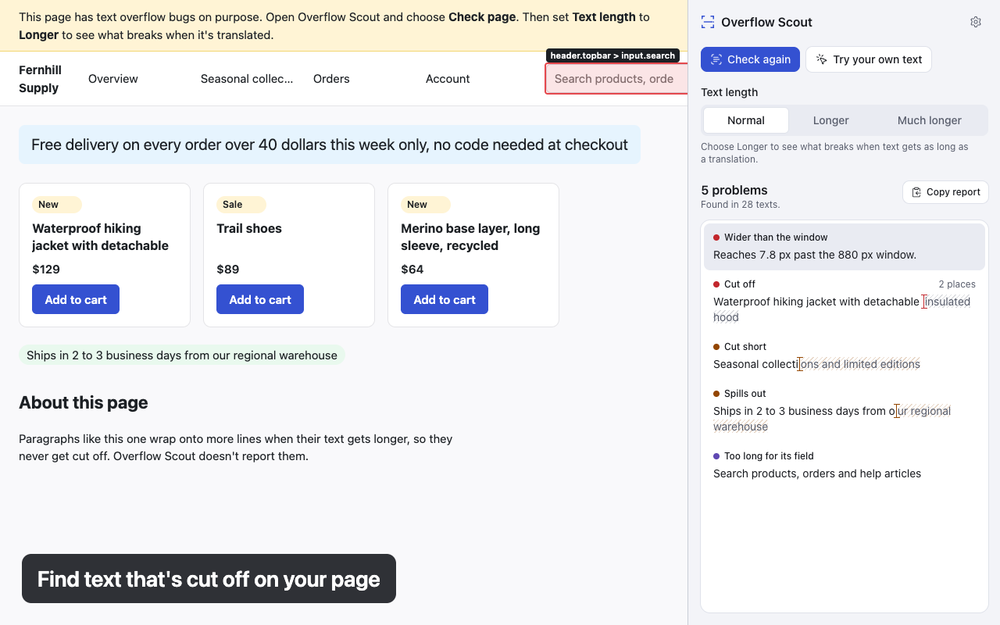

# Overflow Scout

Find text that gets cut off, before your users do.



Overflow Scout is a Chrome extension for frontend developers, QA and designers. It works in
Chrome's side panel, next to the page:

- **Check page** finds every text that is cut off with no sign, cut short with "...", spills out
  of its box, or makes the page scroll sideways, and says how much doesn't fit.
- **Text length** (Normal, Longer, Much longer) makes every text as long as a translation would
  be, by repeating some of its own words, and shows what breaks. **Custom** makes it as many
  times as long as you choose. **Normal** puts the page back exactly. Each tab keeps its own
  results while you look at another.
- **How to fix it** suggests CSS fixes for each problem and tries each one on the page, so you
  know whether it works and how the box changes.
- **Try your own text** puts any text in any element, live: type your own, or fill it with a
  longer version, a long name, a long link or a paragraph.
- **Reports**: copy Markdown for GitHub or Jira, copy or download a cropped screenshot, or save
  everything as JSON.

Everything runs in your browser. It collects no data, has no analytics and makes no network
requests ([privacy policy](site/privacy.html)).

## Install

- **Chrome Web Store:** [Overflow Scout](https://chromewebstore.google.com/detail/overflow-scout/mfinclnlokodigpdeefonldgmcdgnpim)
  (Chrome 142 or later).
- **From a release:** download the zip from [Releases](https://github.com/baselissmail/overflow-scout/releases),
  unzip it, open `chrome://extensions`, turn on **Developer mode**, choose **Load unpacked**, and
  select the unzipped folder.

## Using it

Click the Overflow Scout button in the toolbar (or press <kbd>Alt</kbd>+<kbd>Shift</kbd>+<kbd>O</kbd>)
to open the side panel for the current tab. It has one main screen: **Check page**, **Try your
own text**, and **Text length**. A problem's details, your own text and Settings each open one
step in, with **Back** (or <kbd>Esc</kbd>) to return. Right-click a page and choose **Try your own
text here with Overflow Scout** to go straight to the picker. Nothing runs on a page until you
ask, and closing the panel puts the page back exactly as it was. **Open the demo page** in the
panel opens a page with overflow bugs on purpose. Press <kbd>Cmd</kbd>/<kbd>Ctrl</kbd>+<kbd>K</kbd>
for every command, and <kbd>?</kbd> for keyboard shortcuts.

The extension works on a site only after you click its button there. To skip the click on a site
you use often, choose **Always allow on this site**; Settings lists those sites so you can remove
them.

## Development

Requirements: Node (version in [.nvmrc](.nvmrc)) and pnpm (version pinned in `package.json`).

```sh
pnpm install                           # also installs git hooks
pnpm exec playwright install chromium  # once, for engine and e2e tests
pnpm dev                               # Chrome with the extension loaded and hot reload
```

| Command             | What it does                                                                                                                 |
| ------------------- | ---------------------------------------------------------------------------------------------------------------------------- |
| `pnpm build`        | Production build in `.output/chrome-mv3`                                                                                     |
| `pnpm zip`          | Store-ready zip                                                                                                              |
| `pnpm check`        | Types, lint, formatting, unit and engine tests                                                                               |
| `pnpm test`         | Unit tests (Node)                                                                                                            |
| `pnpm test:browser` | Engine and framework tests in real Chromium                                                                                  |
| `pnpm build:e2e`    | Build for e2e tests (production + access to a test origin)                                                                   |
| `pnpm test:e2e`     | End-to-end tests (run `pnpm build && pnpm build:e2e` first)                                                                  |
| `pnpm size`         | Bundle size budgets (build first)                                                                                            |
| `pnpm dogfood`      | Run the engine on real sites and write contact sheets to `.dogfood/` (needs the network; [results](docs/dogfood/2026-11.md)) |
| `pnpm store:assets` | Icons, promo tiles and store screenshots in `store/` ([releasing](docs/RELEASING.md))                                        |

How to test a release by hand: [docs/TESTING.md](docs/TESTING.md). How to release: [docs/RELEASING.md](docs/RELEASING.md).

To load a build manually, open `chrome://extensions`, enable Developer mode, choose
**Load unpacked** and select `.output/chrome-mv3`.

### Project layout

```
src/
  entrypoints/  background service worker, side panel (and later the page runtime)
  core/         pure detection and text logic: no extension or UI APIs
  ui/           design tokens and components
  locales/      UI strings (en)
tests/
  engine/       Vitest browser-mode tests (real layout)
  frameworks/   The same app in React, Vue and Svelte, stressed while it re-renders
  e2e/          Playwright tests with the built extension
docs/
  REFACTOR_PLAN.md   roadmap and specification
  adr/               architecture decision records
```

Layer rules are enforced by ESLint (`eslint-plugin-boundaries`); see
[docs/REFACTOR_PLAN.md §2.4](docs/REFACTOR_PLAN.md).

## Contributing

See [CONTRIBUTING.md](CONTRIBUTING.md).

## License

[MIT](LICENSE) © Basel Issmail
